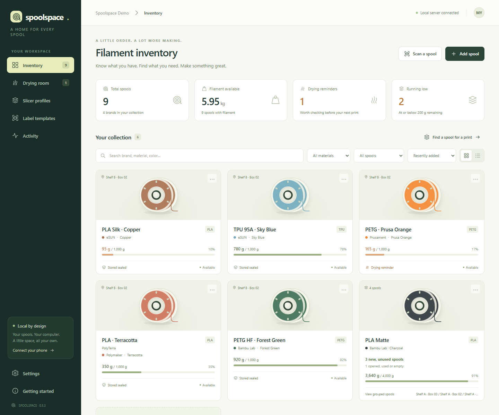
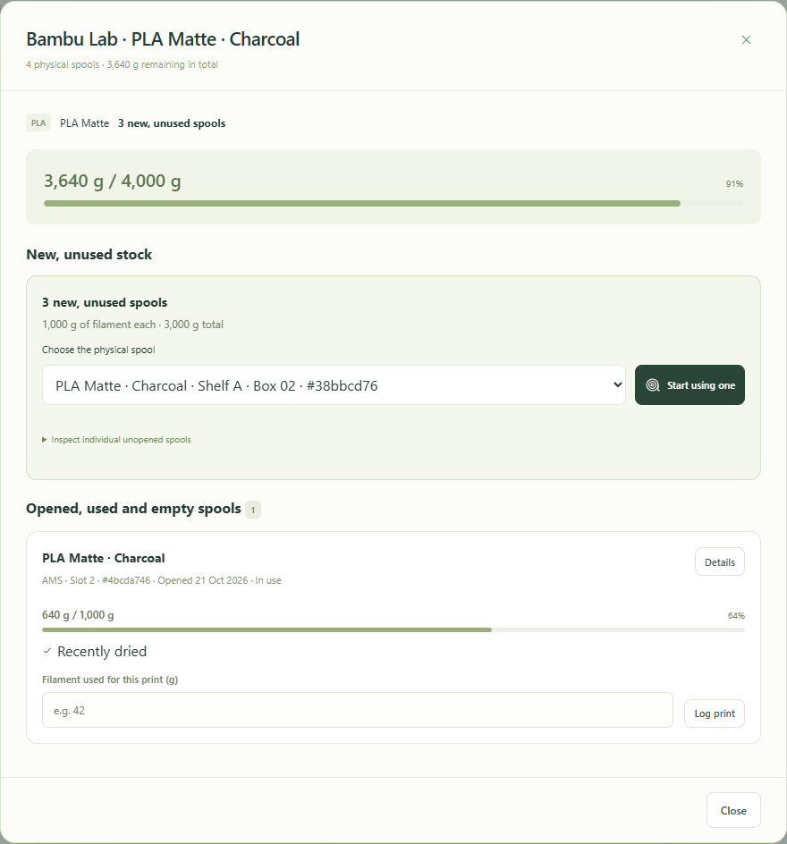
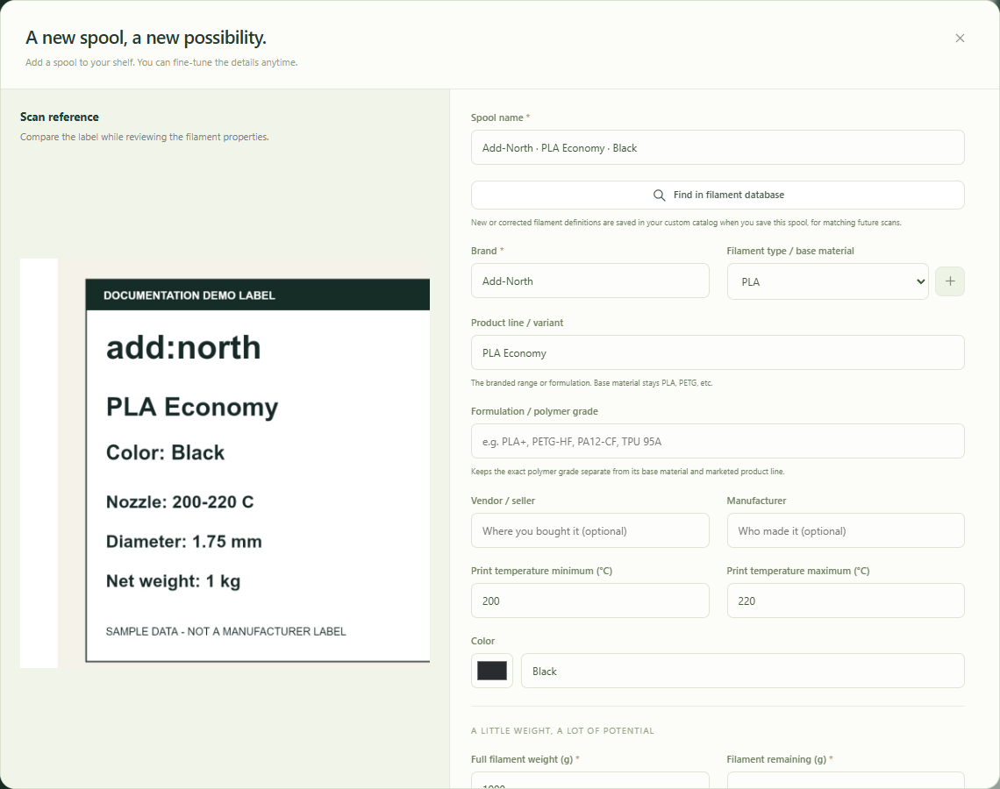
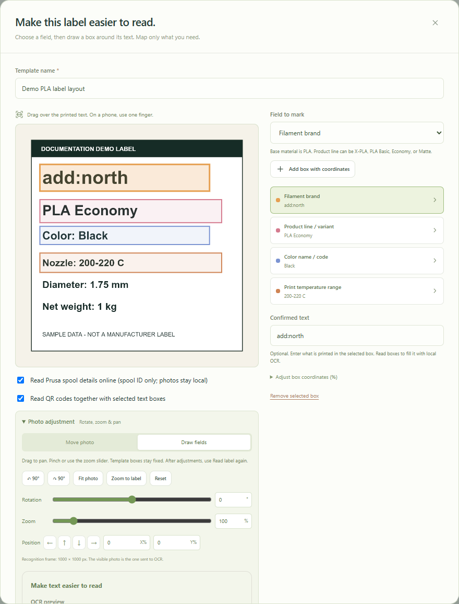
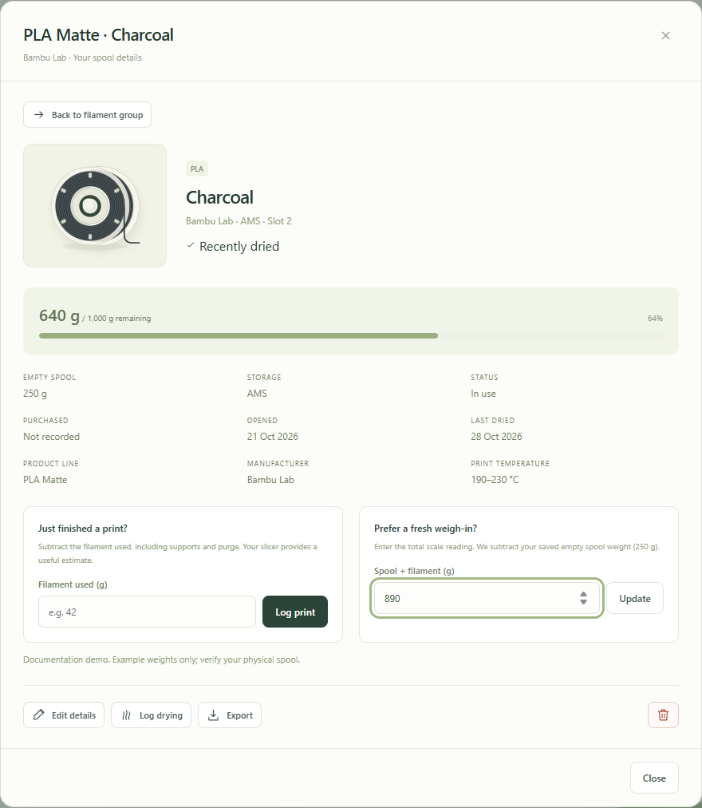
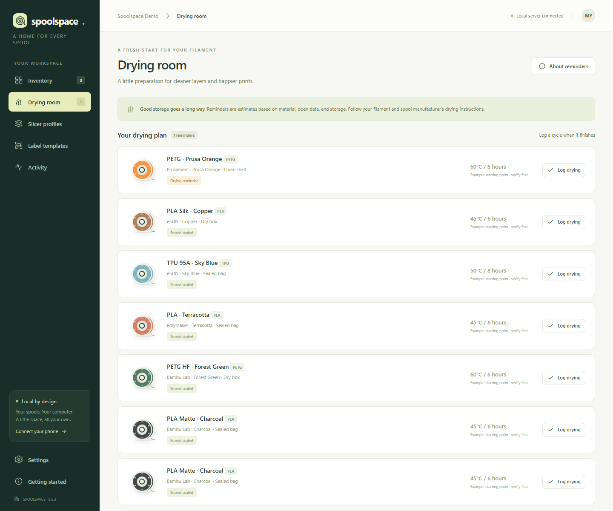

# Spoolspace user guide

Spoolspace keeps track of physical filament spools on your own computer. Open the same library from your Windows browser or a phone on your home Wi-Fi. This guide describes version 0.5.3, which uses HTTP by default.



All screenshots use an isolated demo library. The scan/template image is a synthetic label marked as sample data. Phone pictures show the responsive layout in a mobile-sized test browser.

## Start here

1. Install the Windows setup EXE, or extract the portable ZIP and run `Spoolspace.exe`.
2. Open the desktop shortcut. The default address is **http://localhost:4173**.
3. Open **Settings** and choose your workspace name and low-stock threshold.
4. If you are exploring a source/demo installation, replace sample inventory with your own records. **Clear sample inventory** removes the current collection, including any real spools you have added; export a backup first if needed. Installed copies normally start empty.
5. Add one spool, verify its weight, and record its location. Then add the rest of your collection.
6. Export a backup after entering your inventory.

The app stores its data on the server computer. Your phone displays that same collection; you do not need to import or synchronize a second database.

## Install and choose how Windows starts the server

The setup EXE includes its runtime. You do not need to install Node.js separately for the Windows package.

During installation choose a desktop shortcut, optional private-network firewall access and a startup mode:

| Mode                  | When it starts                                             | Best suited to                      |
| --------------------- | ---------------------------------------------------------- | ----------------------------------- |
| Manual                | When you open the Spoolspace shortcut                      | A PC that runs the app occasionally |
| Background at sign-in | After a Windows user signs in, without opening the browser | A workshop PC used every day        |
| Windows service       | At computer startup, without anyone signing in             | An always-on home server            |

To change the mode later, open **Settings → Windows startup** on the Windows computer at its localhost address. Select a mode and choose **Review and apply in Windows**. Review the desktop dialog, save, and accept Windows' administrator prompt. Return to the web page and refresh the setting. The change takes effect at the **next Windows startup**; the current server stays running.

Closing a browser tab does not stop the server. In manual/background mode, use the notification-area Spoolspace menu → **Stop server and exit**. In service mode, use Windows Services to stop the **Spoolspace** service.

When upgrading an installed copy, export a backup, stop the tray server and run the new installer over the existing installation. Inventory is retained. Source and portable copies have separate data folders; use backup/restore when moving between them. See the [Windows installation guide](windows-installation.md) for storage paths, service configuration and migration details.

## Connect your phone

1. Connect the phone to the same trusted Wi-Fi/LAN as the server.
2. On the computer, choose **Connect your phone** or **Settings → Show QR code**.
3. Scan the displayed QR code, or type the displayed address into the phone's browser. It will look like `http://192.168.1.20:4173`; use the address shown by your own server.
4. Open **Scan spool** to choose a photo or take one with the phone's camera.

`localhost` on a phone means the phone itself, so use the computer's displayed network address. The server must stay awake and running. Guest Wi-Fi or router client isolation can block access; the optional installer firewall rule allows the bundled runtime on the private local network.

For a Home Screen shortcut:

- **Android / Chrome:** menu **⋮ → Add to Home screen → Create shortcut**, or the equivalent option offered by your browser.
- **iPhone / Safari:** **Share → Add to Home Screen**.

HTTP needs no certificate setup. Full browser-promoted PWA installation and service workers may be unavailable on HTTP; a Home Screen shortcut remains the intended default. If you used an older HTTPS bookmark or shortcut, replace it with the current HTTP address. Reserve the server's IP address in your router if you want that address to remain stable.

## Understand the inventory



The main inventory shows filament identity, location, remaining grams and a remaining-weight bar. Search by brand, material or color; use material/stock filters and switch between grid and list views.

The bars show **filament weight**, not a measured physical volume. A 1,000 g spool with 640 g remaining shows 64%. Moisture or color cannot reliably tell you how much filament remains.

Matching products are grouped by brand, material, product line/formulation, manufacturer, color and print temperature range. Different capacities appear as separate unopened batches within a group. Each physical spool retains its own ID, location, balance and history.

New, full spools with status **available** and no opening date are collected as, for example, **4 new, unused spools**. Opened, partly used and empty spools are listed separately inside the group. Storage location alone does not split a group; use its physical-spool selector to choose the actual roll you are taking from the shelf.

## Add a spool manually

Choose **Add spool** and complete the form. Use a name you can recognize, such as `PLA Economy · Black`.

| Field                         | What to enter                                      | Example                       |
| ----------------------------- | -------------------------------------------------- | ----------------------------- |
| Brand                         | The name printed on the filament                   | AddNorth                      |
| Base material / filament type | The polymer or blend                               | PLA, TPE, PC-ABS              |
| Product line                  | The marketed range within a material               | PLA Economy, PLA Basic, E-PLA |
| Formulation                   | A separate filled/special formulation, where known | Carbon-fiber filled           |
| Manufacturer                  | Who manufactured it, when known                    | Leave blank if uncertain      |
| Vendor / supplier             | Where you bought it                                | Your filament retailer        |
| Color                         | The exact printed color and a useful swatch        | Signal White                  |
| Full filament weight          | The original net filament capacity                 | 1,000 g                       |
| Filament remaining            | The current net filament balance                   | 640 g                         |
| Empty spool weight            | The tare of the empty spool                        | 220 g, after verification     |
| Location                      | The specific place you can find it                 | Shelf A · Box 02              |
| Storage                       | How it is protected                                | Sealed bag, Dry box           |

Keep base material separate from branding: **PLA** can be the material while **E-PLA**, **PLA Matte** or **PLA Economy** is the product line. Keep complete color names such as **Signal White**.

If a material is missing, choose the small **+** next to its dropdown, enter a name such as `PC-ABS`, then choose **Add type**. This saves the type for future forms without saving the spool itself. Finish the spool form separately.

For an unopened new spool, leave **Opened on** blank and use **available** status. For an opened roll, enter the actual remaining grams and opening date if known. Review all fields and choose **Add to collection**.

The last saved location and storage choices are reused for future new spools. Editing an existing spool preserves its own location; changing and saving its storage settings updates the defaults for subsequent additions.

## Calculate remaining filament with a scale

You can calculate a balance during both **Add spool** and **Edit spool**:

1. Enter the full net filament capacity.
2. Enter the verified **Empty spool weight (g)**.
3. Enter **Current spool + filament weight (g)**.
4. Check the automatically calculated remaining grams, then save.

```text
Measured spool + filament: 860 g
Empty spool:              220 g
Remaining filament:       640 g
Original filament:      1,000 g
Remaining bar:             64%
```

The calculation is `measured total − empty spool weight`. The total must not be below the empty spool or imply more filament than the stated capacity. Correct an inconsistent tare/measurement before saving. Clear the total scale reading if you want to enter remaining grams manually.

The empty-spool lookup can reuse a same-brand tare from your inventory and offers some approximate references. Only reuse a tare when construction and size match. Measure your own empty spool for accuracy; a database or recognition suggestion is not a scale measurement.

## Scan a label with text and QR recognition



1. Choose **Scan spool**.
2. Use **Choose photo** for an existing library image, or **Take photo** for camera capture. The browser controls the final picker options.
3. A new upload automatically runs preparation, alignment, label zoom and the first read. A busy overlay shows the stage; let it finish.
4. Review the OCR text, decoded QR values and any catalog candidates. A suggested match is not a saved spool.
5. Choose the appropriate review/manual-entry action, correct the fields, and enter the remaining weight. A recognized new spool needs a real balance or explicit full-spool confirmation.
6. Save the reviewed spool to add it to your collection.

The reference photo remains beside the spool properties on wider screens so you can compare them while scrolling. On a phone the reference appears above the properties. Clicking outside the dialog does not discard the form. Use **Close**, the top-right **X** or Escape deliberately; save before leaving if you want to keep the entry.

### Take a readable photo

- Keep label text horizontal; use landscape orientation when it fits the label.
- Hold the main camera parallel to the flat label area and tap the text to focus.
- Fill most of the frame with the label, retaining useful field edges and any complete QR square.
- Use even light. Avoid flash glare, strong reflections, shadows and motion blur.
- Avoid an ultra-wide lens. Move closer instead of relying on digital zoom.
- For a curved label, take a straighter close-up of the useful text rather than trying to include the whole spool.

Automatic preparation helps, but it cannot restore unreadable or missing print. Retake a blurred image before spending time on templates.

### Adjust the photo and read again

Expand **Photo adjustment** after the first upload/read:

| Control                              | Use it for                                                                      |
| ------------------------------------ | ------------------------------------------------------------------------------- |
| Auto-orient / 90° buttons / rotation | Turn sideways text horizontal and correct small tilt                            |
| Zoom and pan / Move photo            | Fill the square frame and position text beneath fixed template fields           |
| Fit photo                            | Show the whole image again                                                      |
| Enhanced grayscale / black and white | Increase text contrast for OCR                                                  |
| Contrast / sharpening                | Refine readable character edges                                                 |
| Lens correction                      | Reduce bowed straight edges                                                     |
| Straighten: mark 4 corners           | Correct perspective by selecting top-left, top-right, bottom-right, bottom-left |

After adjustments, choose **Read label again**. Adjusting the image does not automatically reread it. The photo moves beneath template boxes; the boxes stay fixed. OCR uses the rendered image you see, while color sampling uses the aligned color copy. Confirm exact color names against the label; room lighting affects apparent color.

### Understand QR results

Keep **Read QR codes together with label text** enabled to combine local QR decoding with OCR. One label/code at a time works best. A manufacturer home-page URL may identify a brand but does not establish material, product line or color. A spool serial is not a remaining-weight measurement.

**Read Prusa spool details online** can enrich a recognized Prusament spool link using its official report. This optional request sends the spool ID, not the photo. Disable it for an offline-only scan. Manufacturer data can supply original production information and verified tare when available; it never measures your current remaining filament. Compare conflicts with the printed label before saving.

Other supported links/identifiers can provide brand clues or match a locally cached product. There is no general automatic lookup of every manufacturer's website. Damaged or unsupported QR codes leave text recognition/manual entry available. AMS RFID reading/writing is not supported.

## Teach a reusable label template



Use a template when a readable label has a repeatable layout but generic recognition misses the useful fields.

1. Open a label photo and choose **Teach this label**.
2. Give the template a name describing the label layout or family.
3. Choose a **Field to mark** and draw a small rectangle around the complete printed value. Repeat for brand, material, product line, color, temperature range or other useful fields.
4. If drawing is difficult, use **Add box with coordinates** and the position/size controls.
5. Choose **Read selected boxes**. Select each box and correct its **Confirmed text** for this example photo.
6. Choose **Save template**, or **Save & review spool** to continue into a separate spool form.

Only mark fields present on that label; optional fields can stay absent. Keep the whole multi-word value or temperature range inside its rectangle.

For a future spool with the same layout, select the saved template and rotate/zoom/pan the new photo beneath its fixed boxes. Read again after adjustments. The app reads the new image; it does not copy the example's color or weight onto each new spool. A different label layout may need another template.

Templates teach OCR where to look, not a general image-recognition model. Saved templates include the example photo in your local database and backups, so keep personal information out of the example image.

## Use the filament database and your custom catalog

Open **Settings → Filament Database**:

1. Choose the database update action to download/update the separate local Open Filament Database cache. An internet connection is needed for this update.
2. Control automatic update checks there if desired.
3. Use **Search catalog / label text** to search a product or paste noisy OCR text.
4. Review a candidate's brand, material, product range, color and available spool sizes. Missing values remain unknown; do not substitute another brand simply because its color matches.
5. Choose **My custom filaments** under **Catalog source** to browse products you have taught through saved spool entries.

Saving a new manual/corrected filament teaches its product identity to your custom catalog for later matching. Adding multiple physical spools reuses the product definition. Deleting/using a physical spool does not remove that definition.

Your custom products are stored separately from the replaceable upstream cache. Updating OFD does not overwrite them. Balances, individual storage and print history remain properties of each physical spool, not catalog product defaults.

## Start one spool from a group and record a print



1. Open a matching filament group.
2. Under **New, unused stock**, choose the physical spool using its location/ID.
3. Choose **Start using one**. This marks it opened/in use without deducting any weight.
4. After the print, find that spool under **Opened, used and empty spools**.
5. Enter **Filament used for this print (g)** and choose **Log print**.

For example, logging 42 g against a 640 g spool leaves **598 g**. Other spools in the group keep their own balances. If you use the individual spool's print-usage form, the same principle applies.

Usage is manual. Spoolspace does not automatically receive a printer's actual usage or update an AMS balance. Avoid logging the same print both in the group and again in the individual spool.

Use the spool's weighing form when you have a current total scale measurement instead. A tare must be recorded first. Weighing replaces the balance with `total − tare`; it is different from deducting a print's usage.

## Find enough filament before printing

Choose **Find a spool for a print**, enter the slicer's estimated usage and allowance, and choose the material. The planner compares that total with individual spool balances. It does not combine separate partly used rolls into one sufficient spool.

Check the proposed material's suitability, drying condition and print settings yourself. Planning does not reserve stock or deduct grams; log the completed print afterward.

## Record storage and drying



The **Drying room** uses your opening/drying dates, storage choice and material defaults to help prioritize checks. It is not a moisture sensor and does not control a dryer.

1. Follow the filament manufacturer's drying instructions and the empty spool's heat tolerance.
2. Complete the actual drying cycle.
3. Open the spool's drying action, enter the actual temperature and duration, then choose **Log completed cycle**.
4. Update storage/location if moving the spool into a sealed bag or dry box.

The app records completion and updates the last-dried date. Example temperatures/times are planning aids, not guaranteed safe values for every product or spool. Sealed storage also does not prove a spool was dry when sealed.

## Export a slicer preset

Open the spool's export action and select **Bambu Studio**, **OrcaSlicer** or **PrusaSlicer**.

For Bambu Studio/OrcaSlicer, enter the **exact name of an installed parent preset** from your slicer. Optionally enter the exact printer preset name. Download the file, select the correct printer/nozzle in the slicer and import through its configuration/preset import menu. PrusaSlicer uses an INI configuration bundle.

| Slicer       | File                     |
| ------------ | ------------------------ |
| Bambu Studio | JSON filament preset     |
| OrcaSlicer   | JSON filament preset     |
| PrusaSlicer  | INI configuration bundle |

Review inherited temperatures, flow, volumetric speed and compatibility before printing. Import menus and installed parent names vary by slicer/version. These exports are a starting point, not a printer calibration. Direct AMS synchronization, RFID writing and automatic printer usage deduction are not implemented.

## Back up and restore

Open **Settings → A backup for peace of mind**:

- **Download backup** exports spools, custom filament definitions, preferences, history and saved label templates/example photos to JSON. Store a copy outside the app's folder and before upgrades, clear/reset operations or migration.
- **Choose backup** imports a JSON file and asks for confirmation before replacing your collection. Check that you selected the intended backup first.

A backup containing custom catalog/template arrays replaces those corresponding libraries. Older backups without those arrays preserve the corresponding current libraries. A failed validation leaves the existing collection in place.

Backups may contain private notes and template photos. Keep them out of public GitHub issues and repositories. Optional HTTPS private keys are not included in inventory backups.

Uninstalling an installed Windows copy retains its data directory. For a full filesystem copy, stop the server before copying the entire active data folder so SQLite files are consistent. Installed, portable and source copies use different default paths; consult the installation guide before moving them.

## Common problems

| Problem                                   | What to check                                                                                                                      |
| ----------------------------------------- | ---------------------------------------------------------------------------------------------------------------------------------- |
| Phone cannot connect                      | Server running/awake; same Wi-Fi; correct server IP rather than localhost; private firewall rule; guest/client isolation           |
| Old HTTPS address no longer works         | Use the HTTP address and replace the old bookmark/Home Screen shortcut                                                             |
| No Android Install button                 | HTTP normally uses a Home Screen shortcut; use the browser menu rather than waiting for a PWA prompt                               |
| Photo picker opens the camera             | Use **Choose photo** for the library and **Take photo** for camera capture; final options depend on the browser                    |
| Wrong brand/material/product suggested    | Review raw OCR and QR evidence; correct fields; choose manual entry or teach a template; do not accept a conflicting catalog match |
| QR identifies only a manufacturer         | Generic website URLs contain no reliable product/color identity; supplement them with readable text or a supported report          |
| Label is unreadable                       | Retake with sharp focus/even lighting; straighten and zoom; use a template for a repeated layout                                   |
| Incorrect remaining grams                 | Verify tare and full capacity; distinguish gross scale weight from net filament; check for duplicate usage logs                    |
| Expected identical spools are not grouped | Compare product line, formulation, manufacturer, complete color and temperature fields                                             |
| A new spool has the previous location     | This is the saved default; change it before saving if this spool is stored elsewhere                                               |
| Preset will not import or stays hidden    | Check exact parent preset name, selected printer/nozzle and inherited compatibility                                                |
| Port is already in use                    | Stop the other Spoolspace instance, or configure a separate port/data directory; do not run two servers against one inventory      |

## What stays local, and what may use the internet

Inventory, photos used for recognition, OCR, QR decoding and custom matching run on your computer. Optional Ollama uses an already installed local vision model; no cloud vision subscription is required.

Internet access is used for software/dependency downloads, OFD updates, the optional supported Prusament report lookup and manufacturer links you choose to open. A QR website link does not automatically upload your photo. The app has no account/login system and is intended for your trusted home network, not public internet hosting.

Further reading: [Windows installation and hosting](windows-installation.md), [Open Filament Database integration](open-filament-database.md), [contributing](../CONTRIBUTING.md), [security](../SECURITY.md).
